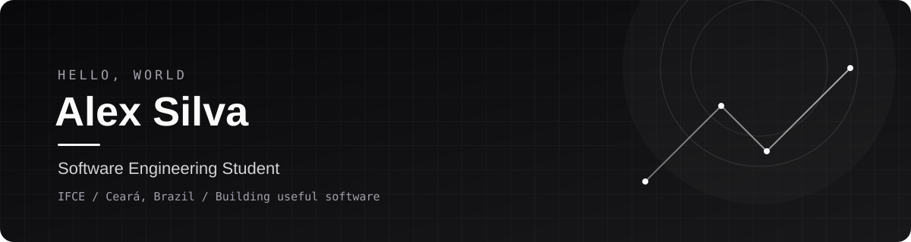

 

## Sobre mim

Sou estudante de **Engenharia de Software no IFCE**, no Ceará, Brasil. Tenho formação técnica em Administração e gosto de conectar tecnologia, processos e necessidades reais de negócio.

Atualmente, estou fortalecendo minha base em programação e desenvolvendo projetos para aprender na prática. Meu objetivo é evoluir como desenvolvedor de software e contribuir com soluções úteis, bem estruturadas e documentadas.

## Tecnologias em estudo

  

## Projetos em destaque

## Estatísticas do GitHub

  
  
   
  

## Vamos conversar?

- **LinkedIn:** [alex-almeida](https://www.linkedin.com/in/alex-almeida-1376912b5/)
- **GitHub:** [@Aleks01-hub](https://github.com/Aleks01-hub)
- **Instagram:** [@alxxsilv](https://www.instagram.com/alxxsilv/)

---

  Aprendendo, construindo e evoluindo um commit de cada vez.

